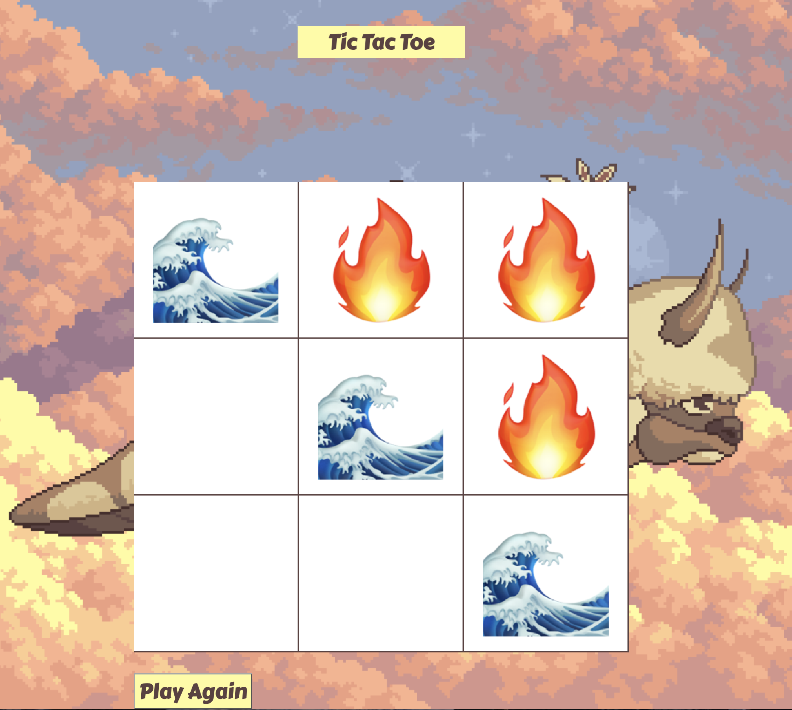

# Project: Tic-Tac-Toe

### Goal: Create a two player Tic-Tac-Toe game. The users should be able to click to place their X or O and if they win the program should mention their win in the DOM. Please make the game as OOP as possible.

### Features: 
- A classic tic tac toe game but it's Avatar the Last Airbender-themed!
- Your Xs and Os are replaced by water and fire signs for my two favorite types of benders.
- If you win or lose, you'll get an alert message

### Tech USed: 
- HTML, CSS, Vanilla JavaScript

### What I learned: 
- In this project, I used floats which was a slight challenge since after beginning to use Flexbox, I never went back...
- It was a great way to practice conditional statements

### How to play?
- check out the live link in the about section of this repo to the right of the screen! 
- Happy Playing!