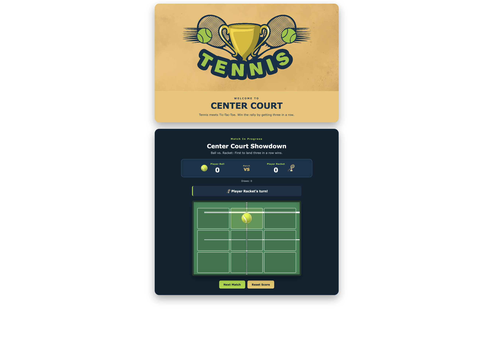

# 🎾 Center Court: Tennis Tic-Tac-Toe
 
A two-player, tennis-themed Tic-Tac-Toe game built with plain HTML, CSS, and object-oriented JavaScript. Player Ball 🎾 and Player Racket 🏸 take turns on a tennis court board, and the first to land three in a row wins the match.
 
 
> A two-player Tic-Tac-Toe game. Users click to place their X or O, and when a player wins, the win is shown in the DOM.
 
🔗 **Live Demo:** [kareemahb.github.io/tic-tac-toe](https://kareemahb.github.io/tic-tac-toe/)
 

 

 
## ✨ Features
 
- **Tennis theme**: a court-style board with lines and a net, tennis ball and racket pieces, and a banner image
- **Turn messages**: shows whose turn it is and announces the winner or a draw
- **Winning-cell highlights**: the three winning squares light up
- **Scoreboard** that tracks wins for each player and draws across matches
- **Next Match** clears the board and keeps the score. **Reset Score** starts everything over.
- **Blocked moves**: clicking a taken square shows a message instead of overwriting it
- **Responsive layout** for desktop, tablet, and mobile

 
## 🔍 How It Works
 
The game is organized into four classes in `main.js`:
 
| Class        | Job                                                                 |
| ------------ | ------------------------------------------------------------------- |
| `Player`     | Holds a player's name, symbol, and CSS class                        |
| `Board`      | Stores the 9 cells, places moves, checks if the board is full, and resets |
| `Scoreboard` | Tracks wins and draws and updates the score display                 |
| `TennisGame` | Runs the game: handles clicks, switches turns, checks for a winner, highlights it, and restarts |
 
After each move, `checkWinner()` checks the board against all 8 winning lines (3 rows, 3 columns, 2 diagonals).
 

 
## 🛠️ Tech Stack
 
- HTML5
- CSS3 (CSS Grid, media queries)
- JavaScript (ES6 classes, arrow functions, array destructuring)
No frameworks, dependencies, or build tools.
 

 
## 📁 Project Structure
 
```
tic-tac-toe/
├── index.html              # Banner, scoreboard, court board, and buttons
├── style.css               # Tennis court styling and responsive layout
├── main.js                 # Player, Board, Scoreboard, and TennisGame classes
├── images/
│   └── tennis banner.jpg   # Banner image
└── image.png               # README screenshot
```
 
---
 
## 🚀 Getting Started
 
Try it live on **[GitHub Pages](https://kareemahb.github.io/tic-tac-toe/)**, or run it locally:
 
```bash
git clone https://github.com/kareemahb/tic-tac-toe.git
cd tic-tac-toe
```
 
Open `index.html` in your browser, or use the **Live Server** extension in VS Code.
 
---
 
## 💡 What I Learned
 
- Splitting a program into classes that each have one job
- Having classes work together (`TennisGame` uses `Player`, `Board`, and `Scoreboard`)
- Using arrow functions so `this` still points to the class inside event listeners
- Checking win conditions by looping over winning combinations with array destructuring
- Keeping game data (the `Board` class) separate from what's shown on the page
---
 
## 👩‍💻 Created By
 
**Kareemah Bahaadur**
[GitHub](https://github.com/kareemahb)
