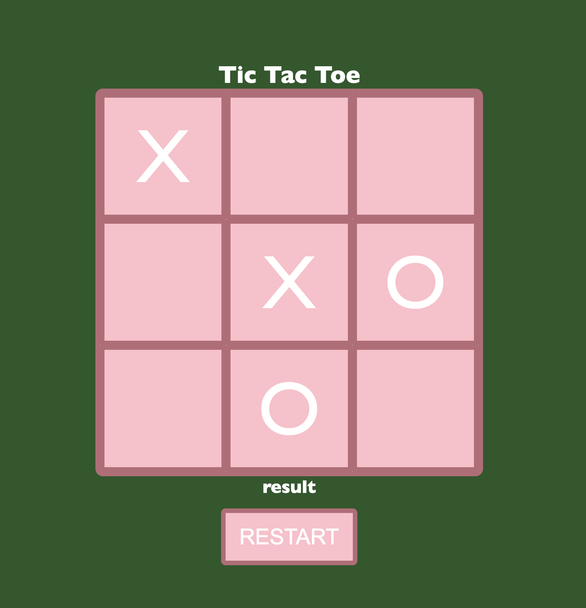

# Tic-Tac-Toe

A two-player **Tic-Tac-Toe game** where players take turns placing X's and O's until someone wins. 🎮

🔗 **[Play the Live Demo](https://tic-tac-toe-mayanja.vercel.app)**

## 📸 Project Preview

<!-- Add your screenshot below -->


## ✨ Features

- Two-player gameplay
- Click to place an X or O
- Players take turns automatically
- Displays the winner on the page
- Built using object-oriented programming (OOP)
- Dynamically update the page using JavaScript
- Simple and user-friendly interface

## 🛠️ Built With

- HTML
- CSS
- JavaScript (OOP)

## 💡 What I Learned

This project gave me more practice organizing code with **object-oriented programming** while building an interactive game.

I also gained more experience working with:

- Classes and constructors
- Methods
- Event listeners
- DOM manipulation
- Arrays
- Conditional logic
- Tracking player turns
- Checking win conditions
- Dynamically updating content

One of the biggest takeaways was learning how to **structure a game with classes** so the code is organized and easier to maintain.

## 🚀 Running the Project

To run this project locally:

1. Clone the repository:

```bash
git clone https://github.com/smayanja3/tic-tac-toe.git
```

2. Navigate into the project folder.

3. Open the project in VS Code.

4. Open `index.html` in your browser.

5. Take turns clicking the board and see who wins! 

---

Thanks for checking out my project! 