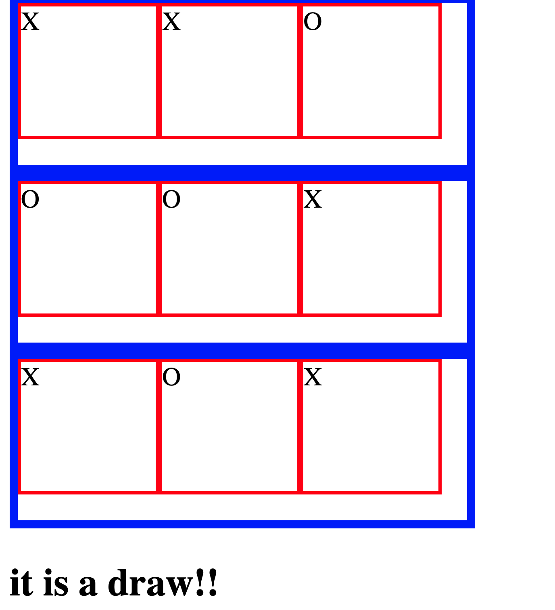

# Tic-Tac-Toe

A two-player Tic-Tac-Toe game built with HTML, CSS, and object-oriented JavaScript. Players take turns clicking a square to place their X or O, and the winner is announced right on the page.

## Demo

Live: [Live Demo](https://morning-challenge-tic-tac-toe-two.vercel.app/)



## The Challenge

This project is a Resilient Coders morning challenge. The goal was to:

- Build a two-player Tic-Tac-Toe game
- Let players click to place their X or O
- Show the winner in the DOM when someone wins
- Structure the code as object-oriented as possible

## Features

- Two players take turns as X and O
- Click a square to place a mark; filled squares can't be overwritten
- Detects wins across rows, columns, and diagonals
- Displays the winner on the page 
- Reset button to start a new game


## Built With

- HTML5
- CSS3
- JavaScript (ES6 classes)

## Getting Started

1. Clone the repo
   ```bash
   git clone https://github.com/sabrinalindev/morning-challenge-tic-tac-toe.git
   cd morning-challenge-tic-tac-toe
   ```
2. The solution is on the `answer` branch
   ```bash
   git checkout answer
   ```
3. Open `index.html` in your browser

No build step or dependencies are required.

## Project Structure

```
morning-challenge-tic-tac-toe/
├── index.html      # Game page
├── css/            # Styles
└── js/             # Game logic
```

## What I Learned

- How to model a game with JavaScript classes and methods
- How to check win conditions with arrays of winning combinations
- How to update the DOM based on game state


## Credit

Challenge from [Resilient Coders](https://github.com/Resilient-Labs/morning-challenge-tic-tac-toe).