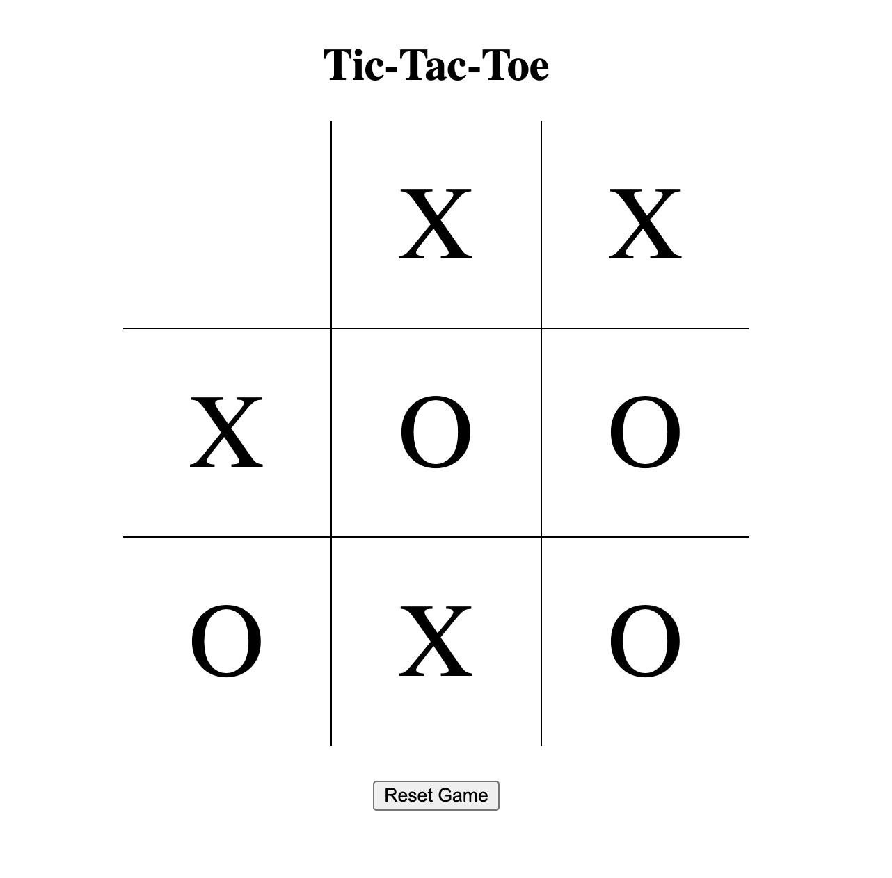

# Tic-Tac-Toe

A two-player Tic-Tac-Toe game in the browser. X goes first, three in a row wins.



## What it does

- A 3×3 board. Click an empty square to place your symbol — Player 1 is X, Player 2 is O, and turns alternate.
- Clicking a square that is already taken does nothing.
- A win (any row, column, or diagonal) or a full-board tie is announced in an alert.
- The Reset Game button clears the board and starts over with X.

## Tech stack

- HTML, CSS, vanilla JavaScript — no server, no dependencies
- Players are built with a small `playerInfo` class (name and symbol)

## How to run it

There is no server to start. Open `tic-tac-toe/index.html` in a browser (or serve the `tic-tac-toe` folder with a static server such as VS Code Live Server).

## Project structure

```
tic-tac-toe/
  index.html         - the board (9 squares, Reset Game button)
  js/main.js         - players, turns, win/tie checks, reset
  css/style.css      - board styling
```

---

Thay Brown — thaybrown22@gmail.com · https://thaythecoder.netlify.app · https://github.com/tbrown320 · https://www.linkedin.com/in/thaybrown
