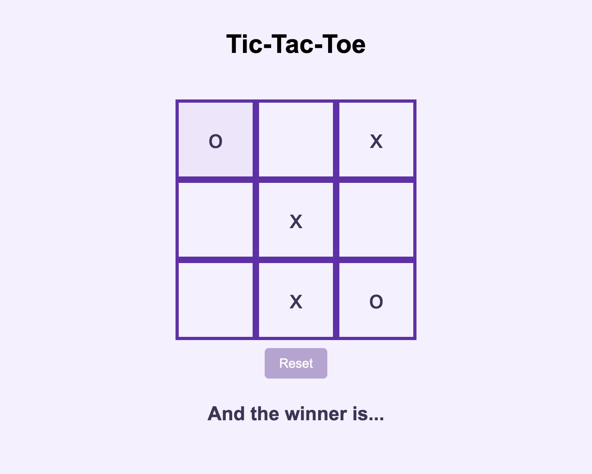

# ❌⭕ Tic-Tac-Toe

Tic-Tac-Toe is a two-player game built with HTML, CSS, and JavaScript. Players take turns placing their marks on the board while the application keeps track of the game and determines when a player wins.

I built this project to strengthen my understanding of JavaScript game logic, objects, DOM manipulation, and managing changing information throughout an application.

## 📸 Project Preview

## ✨ Features

- Two-player gameplay
- Alternate turns between players
- Place player marks on the game board
- Prevent already selected spaces from being reused
- Check the board for winning combinations
- Display the winner when a player wins
- Responsive game board

## 🛠️ Built With

- HTML5
- CSS3
- JavaScript

## 🧠 What I Learned

This project helped me strengthen my understanding of:

- Working with JavaScript objects
- Managing game state
- Tracking player turns
- Using event listeners for player interactions
- Selecting and updating DOM elements
- Writing conditional game logic
- Comparing values to determine a winner
- Breaking larger problems into smaller functions
- Connecting JavaScript logic to an interactive interface

## 🎮 How It Works

Two players take turns selecting spaces on a 3x3 game board.

Each selection updates the board with the current player's mark before switching to the next player. As the game progresses, the application checks the board for a winning combination.

A player wins by placing three matching marks in a row horizontally, vertically, or diagonally.

## 💡 Project Focus

One of the biggest goals of this project was learning how to manage multiple pieces of information at the same time.

The application needs to keep track of the players, whose turn it is, which spaces have already been selected, and whether the current board contains a winning combination.

Building the game helped me practice organizing that logic instead of treating each interaction as an isolated event.